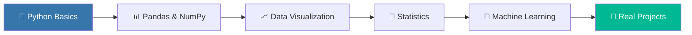

<!-- Waving animated header -->

<!-- Typing animation -->

 

---

## 🧑‍💻 About Me

Hello! I'm Muzamil, an aspiring Data Scientist who loves turning data into meaningful insights. 🚀

🎓 Education: Intermediate in Computer Science (ICS)
🏫 Training: AI & Data Science student at SMIT (Saylani Mass IT Training)
🐍 Currently learning: Python
🌱 Next on my list: Pandas, NumPy, Data Visualization & Machine Learning
🎯 Goal: Become a professional Data Scientist
💡 Mindset: Consistency beats motivation
🤝 Open to: Learning together, collaborating on beginner-friendly projects, and getting feedback
---

## 🔭 What I'm Up To

| 🎯 Focus | 📌 Status |
|---|---|
| 🐍 Python Fundamentals |  |
| 📊 Data Analysis (Pandas, NumPy) |  |
| 📈 Data Visualization (Matplotlib, Seaborn) |  |
| 🤖 Machine Learning (Scikit-learn) |  |

---

## 🛠️ Tech Stack

  

🌱 Pandas & NumPy are on my learning roadmap

---

## 📁 Featured Project

---

## 📊 GitHub Stats

 

 

---

## 🗺️ My Data Science Roadmap

---

## 💬 Quote of the Day

---

## 🤝 Let's Connect

 

⭐ *If you like my journey, drop a follow — I'm just getting started!* ⭐

